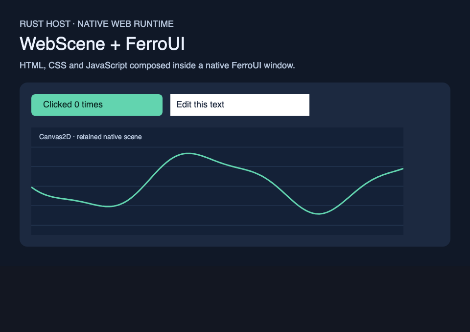

# WebScene for FerroUI

`webscene` hosts WebScene documents in a native Rust/FerroUI control. It
loads the WebScene native engine directly; no .NET runtime or WebView is required.
This is an initial desktop presenter, ported from the Avalonia backend on the
**WebScene 1.0.37 NuGet release commit
`6f58dcf018d7380f80320f48b7c48c8486e99351`**. The presenter uses the published
[FerroUI 0.5.0 crates](https://crates.io/crates/ferroui/0.5.0).



## Run the example

Install Rust, a C/C++ toolchain, libclang, Python 3, and Ninja. Skia may build from
source when its release does not contain a binary for the selected features. On
Linux, FerroUI also requires the platform development libraries described in its
[build documentation](https://github.com/wieslawsoltes/FerroUI).

From this directory:

```sh
# Downloads NuGet 1.0.37 for this machine and checks all four payload hashes
# against the package's native runtime manifest. Prints the native library path.
python3 tool/fetch_runtime.py

cargo run --locked --example showcase -- /absolute/path/to/libwebscene_native_engine.dylib
```

Use `webscene_native_engine.dll` on Windows or `libwebscene_native_engine.so` on
Linux. Keep `icudtl.dat`, `webscene_bootstrap_snapshot.bin` and
`webscene_bootstrap_snapshot.meta` beside the library. The helper puts these in
`target/runtime/1.0.37/<rid>/`. An optional second argument selects another absolute
document URL, including a `file:` URL. The default example exercises DOM text,
rounded boxes, a clickable button, text input, and a Canvas2D chart.

`WEBSCENE_SMOKE_EXIT_MS=3000` closes the example automatically. On this development
machine, the installed Xcode 27 SDK triggers a rust-skia 0.153.3 bindgen error
(`std___hash_table___node_allocator`). Selecting the installed macOS 26.5 SDK with
`SDKROOT` avoids that upstream issue; this is not needed on unaffected SDKs.

## Embed the control

The Cargo package and Rust import are both named `webscene`. Add a path dependency
to your FerroUI 0.5.0 application. Use `=0.5.0` for any direct FerroUI dependencies
so that your application and WebScene share the same control types.

```toml
[dependencies]
webscene = { path = "../WebScene/src/WebScene.Backend.FerroUI" }
```

After setting up FerroUI with its Skia renderer:

```rust,no_run
use webscene::{RuntimeOptions, WebSceneView};

let view = WebSceneView::new();
view.on_error(|error| eprintln!("WebScene: {error}"));
view.on_diagnostic(|json| eprintln!("{json}"));
view.on_host_request(|json| {
    // Application-owned capabilities: clipboard, downloads, external links, etc.
    eprintln!("Host request: {json}");
});
view.open(RuntimeOptions::new("/absolute/path/to/native/library"))?;
view.load_url("https://example.test/application.html")?;
// Place `view` in the FerroUI visual tree, e.g. as Window.Content.
view.execute_script("document.body.style.background = '#182338'")?;
# Ok::<(), webscene::Error>(())
```

`RuntimeOptions` accepts an optional compilation cache directory, console capture,
and an `Arc<dyn ResourceLoader>`. The default loader handles file and HTTP(S)
resources, including GET/POST request bodies. Custom loaders can supply packaged
assets and enforce application-specific origin/access policy. Loader callbacks
run on the native worker: they must not access FerroUI objects or call the engine.
The two-call resource copy protocol fetches a response once, including POSTs.
PNG/JPEG image bytes are carried through the same SVG envelope as Avalonia.

`on_diagnostic` receives native JSON diagnostics for exceptions and resource
failures; console messages are opt-in. `on_error` reports terminal runtime or
presenter failures, also available through `last_error()`. Host requests are
forwarded as JSON to the application. Callbacks run on the UI thread after the
engine borrow is released, so they can execute scripts or close the control.

Each navigation creates a fresh engine, retaining viewport, scale, visibility and
color scheme. `execute_script` queues work asynchronously; applications that need
to sequence native input after a script should wait for an application-level
acknowledgement.

`close()` stops the timer and synchronously destroys the engine. Detaching hides
the engine and stops its timer; reattaching resumes it. Dropping a view also stops
its timer. The loaded native module stays resident because V8 owns process-wide
state. A process can use multiple engines from one native library, but cannot
switch between runtime builds.

## Implementation and scope

- ABI bindings are generated from the included release header. Engine ABI **3**
  deliberately retains scene-view ABI **2**. A test detects divergence from the
  repository's native header.
- Immutable native scenes are copied under their leases, validated, compiled and
  acknowledged in order. A missing base revision requests a checkpoint. Candidate
  state is committed only after all its layers compile successfully.
- DOM backgrounds and foregrounds surround retained Canvas2D layers, matching the
  Avalonia presentation model. Canvas layers are isolated so `clearRect` and
  compositing cannot erase the document behind them. Canvas sources are compiled
  before dependent `drawImage` operations, including reversed DOM order.
- Skia custom draw operations own immutable pictures, independent of native
  engine lifetime. DOM text, rectangles, rounded/elliptical corners, side borders,
  clipping, transforms, opacity, shadows, simple linear gradients, SVG, and the
  Canvas2D path/state/text/compositing operations are implemented.
- Text layout callbacks and painting use the same Skia fonts and HarfBuzz glyph
  advances, with Unicode bidi ordering, font fallback, letter and word spacing.
  HarfBuzz is shared with FerroUI; Skia's separate textlayout library is disabled.
  SVG uses resvg and retains a raster at twice its logical size in the Skia picture.
- The focusable control forwards pointer buttons and modifiers, capture and
  capture loss, wheel, keys, Unicode scalar text, surface exit, logical viewport
  size and device scale. It exposes native cursors and color-scheme selection.
- The composited control submits animation frames and consumes published scenes
  on FerroUI's render clock. It invalidates the composition visual when the
  retained frame changes. Layout size changes enqueue a paired resize and
  animation frame immediately. While the worker lays out the new viewport, the
  compositor clips the previous frame at its original scale. A completed resize
  also wakes the compositor during a native window drag. The dispatcher timer
  handles scale, cursor, and diagnostics, and drives presentation when a
  composition visual is unavailable.
  It stops while detached.
- The showcase uses a persistent per-user cache for assets and compiled scripts.
  Set `WEBSCENE_CACHE_DIR` to override its location. The HTTP loader honors
  freshness and revalidates cached assets using ETag or Last-Modified.

This is not feature parity with `WebScene.Sdk.Avalonia`. Packaged Component Profile
validation/lifecycle, typed interop and Inspector/CDP wrappers, web-font
registration, full IME composition, accessibility tree projection, host-service
implementations, and GPU texture import/Canvas checkpoint transfer remain outside
this crate. It requires the **Skia** FerroUI backend. Complex CSS background
repeat/position/size combinations and full SVG/CSS fidelity are not certified.
Unknown draw command kinds produce an error instead of acknowledging a partial
frame. The existing Avalonia and Uno backends are unchanged.

The crate is portable Rust over the desktop native ABI, but **macOS arm64** is the
locally exercised platform. Windows and Linux builds and native integrations need
platform validation before being treated as supported releases. The NuGet native
runtime's own OS and architecture requirements still apply.

## Native runtime

The WebScene NuGet package supplies the native engine binaries. Ship the matching
1.0.37 runtime files with your application and pass their native library path
through `RuntimeOptions`.

## Validation

```sh
cargo fmt --check
cargo test --locked --all-targets
cargo test --locked --doc
cargo package --locked

# Explicitly runs real-engine and FerroUI headless integration tests.
export WEBSCENE_NATIVE_ENGINE_LIBRARY=/absolute/path/to/native/library
cargo test --locked --lib --tests -- --include-ignored --test-threads=1

# Optional PNG output from the native renderer and actual FerroUI control tests:
export WEBSCENE_SCREENSHOT=/tmp/webscene-scene.png
export WEBSCENE_CONTROL_SCREENSHOT=/tmp/webscene-control.png
```

The default suite needs no WebScene native library. Integration tests are marked
ignored so CI and consumers must deliberately provide a runtime. They exercise
real V8 document execution, rendering, input dispatch, resize, reload, and control
attach/detach/teardown. The library can also be driven without FerroUI through
`Engine`, for custom presentation or offscreen rendering.
